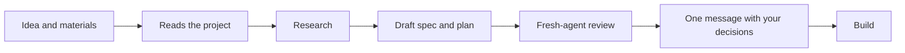

<div align="center">

# Feature Blueprint

**A Claude Code skill that writes the feature spec and the implementation plan before your AI agent writes any code.**

[](https://github.com/nyxandro/feature-blueprint-skill/releases)
[](LICENSE)
[](https://agentskills.io/specification)
[](#install)

**English** · [Русский](README.ru.md)

</div>

Feature Blueprint brings spec-driven development to Claude Code, Codex, OpenCode, Cursor and any
other agent that reads Agent Skills. You give it a rough feature idea. It studies your project,
looks up how others solved the same problem, and writes a spec with a PRD-style product part, a
technical design and a step-by-step plan with tests. Then it asks you only about the decisions
that change the product.

## Why

Hand an AI agent a feature idea and it builds the happy path. Everything else gets filled in
quietly, and usually badly.

- An empty screen says "No data" and offers no next step.
- A spinner never stops.
- A customer gets charged twice after a double click.
- Nobody has ever restored from the backups.
- A sync stopped working a month ago and nobody noticed.

Feature Blueprint makes the agent think these through before the first line of code. It settles
what it can on its own and brings you the rest in plain words, each with a recommendation.

## Install

| Agent | Command |
|---|---|
| Claude Code, as a plugin | `/plugin install feature-blueprint --marketplace nyxandro/skills` |
| Claude Code, Codex, OpenCode, Cursor and others | `npx skills add nyxandro/feature-blueprint-skill` |
| Any agent, by hand | Download the [latest `.skill` archive](https://github.com/nyxandro/feature-blueprint-skill/releases/latest/download/feature-blueprint.skill) and unpack it into the agent's skills folder |

Pick one. If you install it two ways, Claude Code loads the skill twice.

<details>
<summary>More install options</summary>

<br>

- The one-line plugin install needs Claude Code 2.1.275 or later. On an older version, add the
  catalog first with `/plugin marketplace add nyxandro/skills` and then run
  `/plugin install feature-blueprint@nyxandro`.
- The catalog pins no version, so every commit here reaches plugin users as an update. Run
  `claude plugin marketplace update nyxandro` and `claude plugin update feature-blueprint@nyxandro`,
  or turn on auto-update under `/plugin` → Marketplaces.
- With `npx skills`, add `-g` to install the skill for every project. To install a given version,
  add its tag, as in `nyxandro/feature-blueprint-skill@v1.0.0`.
- You can also clone this repository and link the `feature-blueprint/` folder into your agent's
  skills folder. There is no build step.
- The research step needs web search and page fetching. The fresh-agent review needs a tool that
  starts subagents. Without them the skill still works and tells you what it could not check.

</details>

## Usage

Ask for a feature the way you would ask a colleague. These requests all start the skill.

- *Design two-way sync between the agent's reminders and Google Calendar.*
- *Plan a CSV product import for the admin panel and write the spec.*
- *Work out nightly database backups. How much data can we lose, and how do we restore?*
- *Here's the client's chat and brief. Design appointment rescheduling for our Telegram bot.*
- *Check this feature plan for holes.*

The skill stays out of the way when you only want to talk an idea through. Small changes like a
new button or a clear fix skip the spec entirely. The agent says in a few lines what it will
change and does it.

## How it works



1. The agent reads what you gave it and then your project. It looks at how similar things
   already work, how much data there is and who keeps it running. It doesn't ask what the code
   can answer, and it never touches production while designing.
2. It looks up how others solved the same task in official docs, engineering blogs, postmortems
   and popular repositories. For every practice it notes the scale at which it starts to pay off.
3. It writes the whole draft before asking anything, unless a single answer would flip most of
   the design.
4. It picks the simplest option that meets your goals at your project's size, and writes down
   when it would be worth moving up.
5. It checks the draft, then hands it to a fresh agent that has never seen the conversation and
   reads it as the person who has to build it.
6. It saves the spec in `docs/specs/` and sends you one message with the open decisions. If your
   answers don't change the plan, that counts as a go and the agent starts building.

There is also a review mode. Bring an existing plan or pull request and you get the gaps, worst
first. On request the agent also draws HTML mockups of every screen state and diagrams of the
flows.

## Example

Every decision that's yours comes with a real situation, the options and a recommendation. Here
is one from a booking bot for a barbershop.

> **F2. Can a client move an appointment shortly before it starts?**
>
> Oleg is booked for 18:00 with Anna. At 17:20 he moves the visit to tomorrow, and Anna is left
> with a 40-minute gap that nobody can book at such short notice. This affects the barbers' income
> and how strict the shop wants to be. The code works either way.
>
> **A. Free moves until 2 hours before, later only through the admin.** Barbers lose fewer slots.
> At 17:20 Oleg sees "Less than 2 hours left, so the bot can't move this visit. Message the admin
> at @barber_admin." It adds one check and one message, and some clients won't like it. The 2
> hours is a single setting.
>
> **B. Free moves at any time.** Easiest for clients. Barbers lose last-minute slots.
>
> **I recommend A.** The shop already asks for 2 hours' notice on phone bookings
> (`docs/rules.md`), so clients know the rule. If nobody decides, the agent goes with A.

## What's in the spec

| Part | Written for | What's inside |
|---|---|---|
| At a glance | You | What we build and why, how it will work, what to watch, decisions waiting for you, scope in hours |
| For the owner | You | Goals and non-goals, what the design rests on, options compared, scenarios, your decisions |
| Behaviour | The implementing agent | Screen and message states, errors with their full texts, edge cases, how background jobs fail and recover |
| How to build | The implementing agent | What to reuse, the design, steps with tests, acceptance criteria |

The skill itself is written in English. The spec, the questions and the summaries come in the
language you write in.

## What it covers

| Features people use | Internal mechanisms |
|---|---|
| Web apps and admin panels, sites and online shops, mobile and desktop apps, Telegram and other bots, Mini Apps, AI features and agent tools, voice interfaces, CLIs, APIs and webhooks | Backups, sync with external services, queues and background jobs, data migrations, monitoring, integrations |

## Versions

The current version sits in `metadata.version` of `feature-blueprint/SKILL.md`, so any installed
copy tells you which one it is. Every version has a git tag and a
[release](https://github.com/nyxandro/feature-blueprint-skill/releases) with its own archive.
[CHANGELOG.md](CHANGELOG.md) lists what changed.

<details>
<summary>Repository layout</summary>

<br>

```text
feature-blueprint/                    the skill
  SKILL.md                            principles and the order of work
  references/document-template.md     the spec format, plan included
  references/checklists.md            what not to miss, and the self-check
  references/examples.md              good and bad decisions, summaries and plan steps
  references/review-mode.md           finding holes in a ready plan or PR
  references/builder-check.md         the prompt for the fresh-agent review
  references/mockups.md               HTML mockups and diagrams, on request
  evals/                              cases that compare the skill with others, not in the archive
dist/feature-blueprint.skill          the skill folder as a downloadable archive
CHANGELOG.md                          what changed in each version
README.md, README.ru.md               this page in English and in Russian
```

</details>

<details>
<summary>Credits</summary>

<br>

The skill is written from scratch, with ideas from these open projects.

- [EveryInc/compound-engineering-plugin](https://github.com/EveryInc/compound-engineering-plugin)
  (MIT). Build an unrequested mechanism only when its absence harms quietly or is costly to add
  later. Check what two decisions do together and check claims about the project against the
  code. Look at earlier attempts and unwritten rules of the code. Keep production safe after each
  step that ships on its own. Separate the goal from the means and ask how a feature could be
  built as written and still miss the goal.
- [obra/superpowers](https://github.com/obra/superpowers) (MIT). Study the project before asking,
  review the document with a fresh agent, the plan format, rules every step keeps.
- [garrytan/gstack](https://github.com/garrytan/gstack) (MIT). The states table, open decisions
  with what happens if nobody decides, failures on new paths.
- [pbakaus/impeccable](https://github.com/pbakaus/impeccable) (Apache-2.0). Propose the likely
  option and ask for corrections, the edge-case checklist, kinds of empty states.
- [Owl-Listener/designer-skills](https://github.com/Owl-Listener/designer-skills) (MIT). The
  error-handling chain, comparing options by behaviour.
- [bmad-code-org/BMAD-METHOD](https://github.com/bmad-code-org/BMAD-METHOD). Scenarios with real
  people, the section on what we deliberately leave out.
- [anthropics/knowledge-work-plugins](https://github.com/anthropics/knowledge-work-plugins)
  (Apache-2.0). Goals and non-goals, priorities P0 to P2, acceptance criteria.

Research, scale and reliability rules draw on
[Design Docs at Google](https://www.industrialempathy.com/posts/design-docs-at-google/),
[Choose Boring Technology](https://mcfunley.com/choose-boring-technology) and the
[AWS Well-Architected reliability pillar](https://docs.aws.amazon.com/wellarchitected/latest/reliability-pillar/design-principles.html).
Rules for AI agent tools follow Anthropic's
[Writing effective tools for agents](https://www.anthropic.com/engineering/writing-tools-for-agents),
OpenAI's [function calling guide](https://developers.openai.com/api/docs/guides/function-calling)
and the [MCP tools spec](https://modelcontextprotocol.io/specification/2025-11-25/server/tools).

The shape of the skill follows Anthropic's
[skill authoring best practices](https://platform.claude.com/docs/en/agents-and-tools/agent-skills/best-practices),
the [Agent Skills specification](https://agentskills.io/specification), OpenAI's
[Build skills](https://learn.chatgpt.com/docs/build-skills) and the chapters on Agent Skills and
clarifying requirements in Bojie Li's book "AI Agents from the Inside".

</details>

## License

[MIT](LICENSE)
