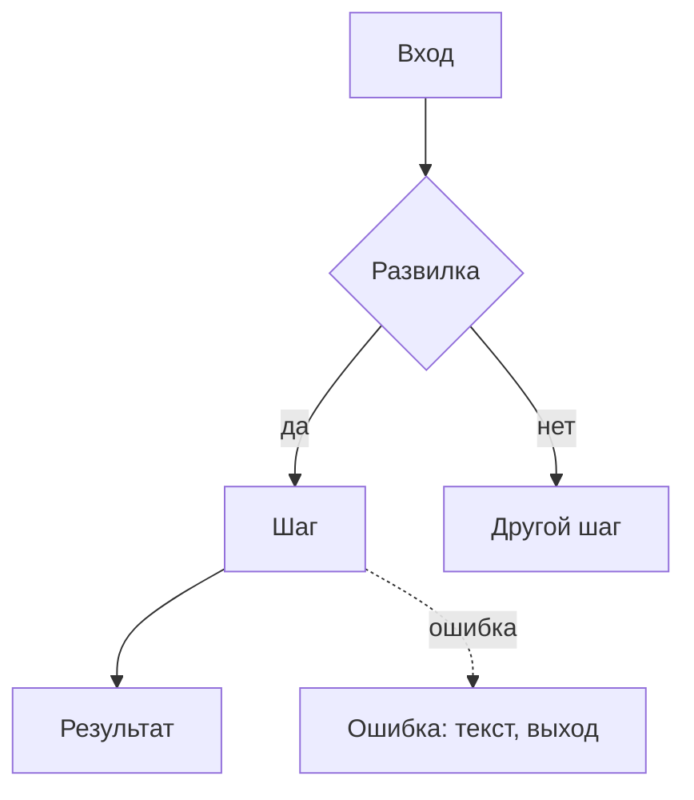

# Шаблон чертежа

Два варианта: полный — для фичи, короткий — для маленькой правки.

У полного чертежа два читателя, и он разделён так, чтобы каждый нашёл своё:

- **Владелец продукта** читает «Главное» и часть 1. Там всё, что нужно для решений: что делаем, как
  это будет для человека, сценарии, развилки. Без технического словаря; если термин неизбежен —
  пояснение при первом упоминании.
- **Исполнитель** (человек или агент, который будет строить и не сможет задать вопросов) читает
  всё, но работает по частям 2 и 3.

Раздел, который к фиче не относится, не удаляй молча: оставь заголовок и одну строку «не
относится, потому что…».

**Объём:** «Главное» — одна страница; «Главное» вместе с частью 1 — до 150 строк; весь полный
чертёж — 300–600 строк. Если выходит больше, ищи повторы, очевидные решения и прозу вместо таблиц.

## Полный чертёж

````markdown
# <Название фичи> — чертёж

**Статус:** черновик, ждёт решений владельца | согласован
**Дата:** ГГГГ-ММ-ДД · **Проект:** <имя> · **Типы интерфейса:** <веб-админка, бот, …>

## Главное

**Что делаем и зачем.** 2–3 строки: для кого, какую боль снимаем, что будет успехом.

**Как это будет для человека.** 5–7 пунктов: путь по шагам и главные решения по поведению, каждое с
последствием для пользователя.

**Ждут вашего решения.**
1. <вопрос> — рекомендую <вариант>, потому что <…> (подробно — Р1)
2. …

**Объём работ:** <оценка в днях по этапам>.

**Не проверено:** <что и почему>.

---

# Часть 1. Для владельца: как это работает

## 1. Что известно и что додумано

- **Сказал владелец:** <вводные своими словами>
- **Нашлось в проекте:** <что важно для решений: похожие функции, ограничения, найденные дефекты>
- **Додумано:** <ключевые допущения с пометкой [ДОПУЩЕНИЕ] и причиной>

## 2. Цели, не-цели, анти-цели

- **Цели:** 2–5 результатов для пользователя и бизнеса.
- **Не-цели:** что не входит в эту версию и почему.
- **Анти-цели:** что сделает фичу провалом, даже если она работает.

## 3. Варианты решения

Только при настоящей развилке; иначе одна строка «путь один, потому что…».

| | Вариант А | Вариант Б |
|---|---|---|
| Что делает человек | | |
| Даёт | | |
| Стоит | | |
| Закрепляет | | |

**Рекомендую:** <вариант> — потому что <…>.
**Отвергнуты:** <вариант> — проиграл на <…>, вернётся, если <…>.

## 4. Сценарии

**Сценарий 1 — <название>.** <Имя, роль, контекст, состояние.>
1. …
2. **Главный момент:** <ради чего всё делается>
- **Если сбой:** <что происходит и как человек выбирается>



## 5. Решения владельца

### Р1. <Вопрос так, как его понял бы владелец>
- **А. <вариант>** — даёт: …; стоит: …; закрепляет: …
- **Б. <вариант>** — даёт: …; стоит: …; закрепляет: …
**Рекомендую А**, потому что <…>.
**Если не решить:** <что сделает разработчик по умолчанию и что увидит пользователь>

### Принято
Заполняется после ответов владельца: решение, дата.

---

# Часть 2. Для исполнителя: поведение в деталях

## 6. Точки контакта и состояния

| Точка контакта | Первый раз / пусто | Загрузка | Есть данные | Частично | Ошибка | Нет прав | Успех |
|---|---|---|---|---|---|---|---|
| <экран, сообщение, команда> | <что видит и может сделать> | | | | | | |

Колонки — под фичу (для бота: «сообщение устарело»; для офлайн-приложения: «нет сети»). Пустых
клеток нет: «не бывает, потому что…» — тоже ответ.

## 7. Ошибки и восстановление

| Ситуация | Как предотвращаем | Что видит человек (текст целиком) | Как выбирается | Что сохраняется |
|---|---|---|---|---|

## 8. Крайние случаи

| Случай | Что происходит | Как обрабатываем |
|---|---|---|

## 9. Скорость и обратная связь

| Действие | Ожидаемое время | Что видит человек, пока ждёт | Если дольше |
|---|---|---|---|

## 10. Тексты интерфейса

| Где | Текст |
|---|---|

Тексты из таблиц ошибок и состояний здесь не повторяй — только остальные ключевые строки.

## 11. Доступность, локализация, деньги, данные, закон

Только то, что касается фичи.

## 12. Что сознательно не делаем

- <паттерн или функция> — потому что <…>

## 13. Решения агента — на проверку

Только те, с которыми владелец мог бы разумно не согласиться (обычно до десяти).

- <решение> — <почему так> (<основание: правило проекта, платформа, практика>)

---

# Часть 3. Для исполнителя: как реализовать

## 14. Что уже есть и переиспользуем
## 15. Устройство
## 16. Ловушки платформы и библиотек
## 17. Сбои на новых путях
## 18. Приоритеты и объём работ
## 19. Шаги
## 20. Критерии приёмки
## 21. На что смотреть при ревью

(Содержимое — по `engineering-plan.md`.)

## 22. Открытые вопросы

| Вопрос | Кто отвечает | Блокирует старт? |
|---|---|---|
````

## Короткий чертёж (маленькая правка)

Объём — до 80 строк.

````markdown
# <Правка> — короткий чертёж

**Статус:** … · **Дата:** … · **Где:** <экран / команда / файл>

**Что и зачем:** 2–3 строки.

**Сценарий:** 3–5 шагов, включая ветку сбоя.

**Состояния:** <только затронутые: загрузка, пусто, ошибка, успех — что видит человек>

**Ошибки и крайние случаи:** <список с обработкой>

**Тексты:** <ключевые строки>

**Решения:** <для владельца — в формате даёт / стоит / закрепляет с рекомендацией; свои — на проверку>

**Шаги реализации:** <файлы, что меняется, какой тест доказывает>

**Критерии приёмки:** <Дано / Когда / Тогда, 2–4 штуки>

**Объём работ:** <оценка>
````

## Правила оформления

- Таблицы вместо прозы, где сравниваются однотипные вещи. Внутри таблицы не бывает пустых строк —
  они разрывают её при отображении.
- Каждый текст для пользователя — целиком, в кавычках, без «показать сообщение об ошибке».
- Одно и то же описывается в одном месте; в других — ссылка на раздел.
- Пути к файлам и имена функций — в обратных кавычках, точно как в проекте.
- Схемы — Mermaid (`flowchart` для сценария, `stateDiagram-v2` для состояний). Их рисуют GitHub,
  GitLab и большинство редакторов Markdown.
- Кликабельный HTML-макет экранов — только по просьбе владельца. Тогда положи его рядом с
  документом и сошлись на него из части 1; при расхождении прав документ, а не макет.
