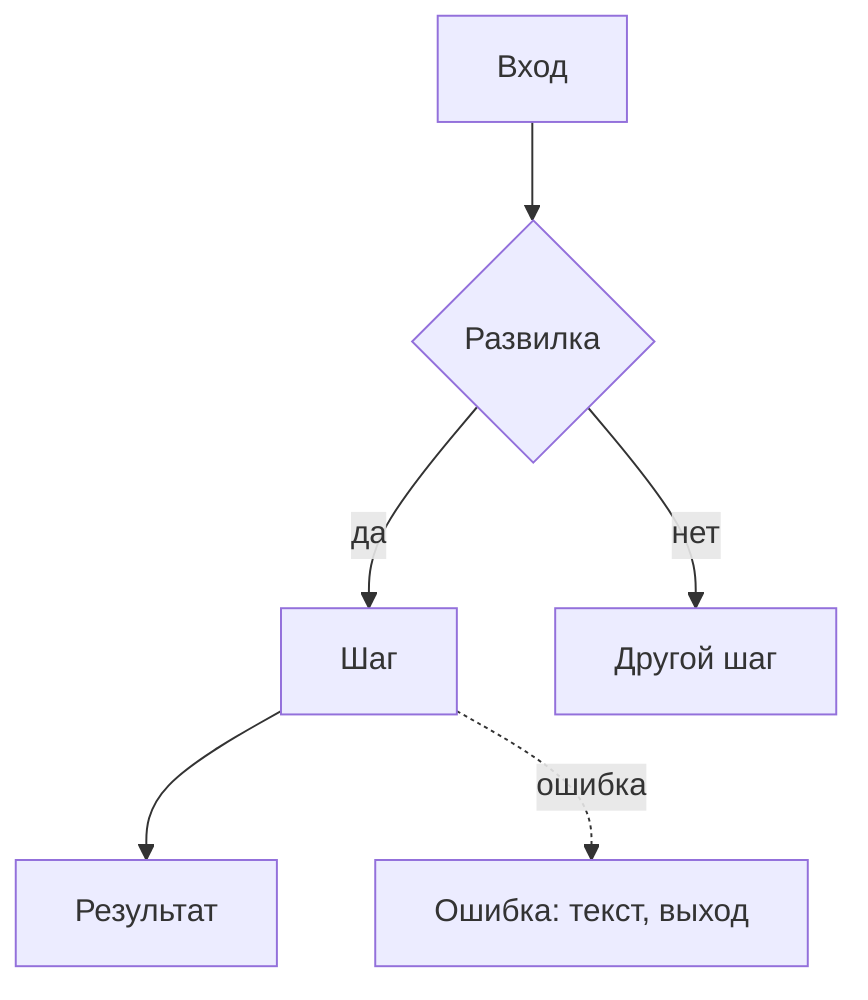

# Шаблон чертежа

Два варианта: полный — для фичи, короткий — для маленькой правки.

У полного чертежа два читателя, и он разделён так, чтобы каждый нашёл своё:

- **Владелец продукта** читает «Главное» и часть 1. Там всё, что нужно для решений: что делаем, как
  это будет работать, на чём основано, развилки. Без технического словаря; если термин неизбежен —
  пояснение при первом упоминании.
- **Исполнитель** (человек или агент, который будет строить и не сможет задать вопросов) читает
  всё, но работает по частям 2 и 3.

Раздел, который к фиче не относится, не удаляй молча: оставь заголовок и одну строку «не
относится, потому что…». У пользовательской фичи без нового механизма так обычно закрываются
разделы 8 и 20, у внутренней — разделы 7, 11 и 12.

**Объём:** «Главное» — одна страница; «Главное» вместе с частью 1 — до 180 строк; часть 2 — до 170;
часть 3 — до 250; весь полный чертёж — 300–600 строк. Если выходит больше, ищи повторы, очевидные
решения и прозу вместо таблиц.

## Полный чертёж

````markdown
# <Название фичи> — чертёж

**Статус:** черновик, ждёт решений владельца | согласован
**Дата:** ГГГГ-ММ-ДД · **Проект:** <имя> · **Тип фичи:** пользовательская | внутренняя | смешанная ·
**Где работает:** <веб-админка, бот, фоновая задача, внешний сервис…>

## Главное

**Что делаем и зачем.** 2–3 строки: для кого, какую боль снимаем, что будет успехом.

**Как это будет работать.** 4–7 пунктов: путь по шагам — что делает человек или что происходит,
когда срабатывает механизм, — и главные решения, каждое с последствием для пользователя или
бизнеса.

**Как будем делать.** 4–8 пунктов высоким уровнем: что появится в системе, что переиспользуем из
проекта, что пишем заново и почему не подошло имеющееся.

**На чём основано.** 2–4 главные опоры: практика или источник → что из этого берём (подробно —
раздел 3).

**Нашлось по дороге.** <устаревший код и старые дефекты в затронутой области: что это и чем
мешает; что с ними делать — в развилках. Если ничего — строку убрать>

**Ждут вашего решения.**
1. <вопрос> — рекомендую <вариант>, потому что <…> (подробно — Р1)
2. …

**Объём:** <N шагов; работа агента — около X ч (оценка); что займёт время на самом деле — прогоны,
CI, внешние ожидания; что нужно от владельца и сколько его времени>.

**Не проверено:** <что и почему>.

---

# Часть 1. Для владельца: как это работает

## 1. Что известно и что додумано

- **Сказал владелец:** <что он сказал или явно подтвердил, в том числе в обсуждении до чертежа;
  рекомендации агента, на которые владелец не ответил, сюда не входят — они в разделе 6>
- **Рекомендовал агент, владелец не подтвердил:** <если было обсуждение — что и где это в развилках>
- **Нашлось в проекте:** <что важно для решений: похожие функции, ограничения, масштаб с цифрами,
  найденные дефекты>
- **Додумано:** <ключевые допущения с пометкой [ДОПУЩЕНИЕ] и причиной>

## 2. Цели, не-цели, анти-цели

- **Цели:** 2–5 результатов для пользователя и бизнеса. Для внутреннего механизма — гарантии в
  числах: сколько данных допустимо потерять, сколько простоять, за какое время доходят изменения.
- **Не-цели:** что не входит в эту версию и почему.
- **Анти-цели:** что сделает фичу провалом, даже если она работает.

## 3. На чём основано

| Практика | Кто так делает | При каком масштабе окупается | Берём сейчас? | Почему | Источник |
|---|---|---|---|---|---|

Только то, что повлияло на решения (по `prior-art.md`). Без пересказа прочитанного.

## 4. Варианты и масштаб

**Масштаб проекта:** <данные, нагрузка, кто обслуживает, бюджет — с источником цифр>.

Если путь один — одна строка «путь один, потому что…». Иначе варианты или лестница ступеней:

| | Вариант / ступень 1 | Вариант / ступень 2 |
|---|---|---|
| Что делает человек или механизм | | |
| От чего защищает / что даёт | | |
| Стоит: сложность и места для сбоев, деньги в месяц, обслуживание | | |
| Закрепляет | | |
| Нужен, когда | | |

**Рекомендую:** <вариант> — потому что <…, со ссылкой на раздел 3>.
**Переходить выше, когда:** <измеримое условие>.
**Отвергнуты:** <вариант> — проиграл на <…>, вернётся, если <…>.

## 5. Как это работает

Для пользовательской фичи — сценарии с конкретными людьми. Для внутреннего механизма — сценарии
его работы: обычный проход, сбой, восстановление; действующие лица — владелец, другие модули,
агент.

**Сценарий 1 — <название>.** <Кто, контекст, состояние.>
1. …
2. **Главный момент:** <ради чего всё делается>
- **Если сбой:** <что происходит, кто узнаёт, как выбираемся>



## 6. Решения владельца

### Р1. <Вопрос так, как его понял бы владелец>
**Почему решать сейчас:** <что от ответа зависит: поведение для людей, данные, деньги, надёжность>
- **А. <вариант>** — даёт: …; стоит: …; закрепляет: …
- **Б. <вариант>** — даёт: …; стоит: …; закрепляет: …
- **В. Самый простой: без этого / как сейчас** — даёт: …; стоит: …
**Рекомендую А**, потому что <…>.
**Если не решить:** <что сделает разработчик по умолчанию и что увидит пользователь>

### Принято
Заполняется после ответов владельца: решение, дата.

---

# Часть 2. Для исполнителя: поведение в деталях

## 7. Точки контакта и состояния

| Точка контакта | Первый раз / пусто | Загрузка | Есть данные | Частично | Ошибка | Нет прав | Успех |
|---|---|---|---|---|---|---|---|
| <экран, сообщение, команда> | <что видит и может сделать> | | | | | | |

Колонки — под фичу (для бота: «сообщение устарело»; для офлайн-приложения: «нет сети»). Пустых
клеток нет: «не бывает, потому что…» — тоже ответ.

## 8. Внутренний механизм: гарантии, данные, отказы

По `internal-mechanics.md`: гарантии в числах, источник правды и правило конфликтов, повтор и
двойной запуск, восстановление и его проверка, доступы. Сигналы о работе и обслуживание — только
в разделе 20, деньги — в разделе 4, что видит человек при сбое — в разделе 9.

| Что ломается | Как предотвращаем | Как узнаём (кто, за какое время) | Как восстанавливаемся | Что теряется | Чем покрыт |
|---|---|---|---|---|---|

## 9. Ошибки и восстановление

| Ситуация | Как предотвращаем | Что видит человек (текст целиком) | Как выбирается | Что сохраняется |
|---|---|---|---|---|

## 10. Крайние случаи

| Случай | Что происходит | Как обрабатываем |
|---|---|---|

## 11. Скорость и обратная связь

| Действие | Ожидаемое время | Что видит человек, пока ждёт | Если дольше |
|---|---|---|---|

## 12. Тексты интерфейса

| Где | Текст |
|---|---|

Тексты из таблиц ошибок и состояний здесь не повторяй — только остальные ключевые строки.

## 13. Доступность, локализация, деньги, данные, закон

Только то, что касается фичи.

## 14. Что сознательно не делаем

- <паттерн, функция или ступень> — потому что <сейчас не нужно людям / ждём данных / лишнее
  обслуживание на нашем масштабе>; вернёмся, когда <условие>. «Дольше делать» — не причина

## 15. Решения агента — на проверку

Только те, с которыми владелец мог бы разумно не согласиться (обычно до десяти). Всегда — решения
мимо того, что в проекте уже есть (своя реализация вместо имеющейся интеграции, новая зависимость,
второй путь для того же), с причиной, почему имеющееся не подошло. Новые для человека настройки,
кнопки и сообщения, о которых владелец не просил, сюда не входят — это развилки раздела 6.

- <решение> — <почему так> (<основание: правило проекта, документация, практика из раздела 3>)

---

# Часть 3. Для исполнителя: как реализовать

## 16. Что уже есть и переиспользуем
## 17. Устройство
## 18. Ловушки платформы и библиотек
## 19. Сбои на новых путях
## 20. Обслуживание
## 21. Приоритеты и объём
## 22. Шаги
## 23. Критерии приёмки
## 24. На что смотреть при ревью

(Содержимое — по `engineering-plan.md`.)

## 25. Открытые вопросы

| Вопрос | Кто отвечает | Блокирует старт? |
|---|---|---|
````

## Короткий чертёж (маленькая правка)

Объём — до 80 строк.

````markdown
# <Правка> — короткий чертёж

**Статус:** … · **Дата:** … · **Где:** <экран / команда / файл / задача>

**Что и зачем:** 2–3 строки.

**Вводные:** <что сказал или подтвердил владелец> · <что додумано или рекомендовано агентом без
подтверждения — это в «Решениях»>

**Опора:** <документация или практика, на которой держится решение>

**Переиспользуем:** <что из проекта; что идёт мимо имеющегося и почему>


**Сценарий:** 3–5 шагов, включая ветку сбоя.

**Состояния:** <только затронутые: загрузка, пусто, ошибка, успех — что видит человек>

**Отказы:** <для внутренней правки: что ломается, как узнаём, как восстанавливаемся>

**Ошибки и крайние случаи:** <список с обработкой>

**Тексты:** <ключевые строки>

**Решения:** <для владельца — в формате даёт / стоит / закрепляет с рекомендацией; свои — на проверку>

**Шаги реализации:** <файлы, что меняется, какой тест доказывает>

**Критерии приёмки:** <Дано / Когда / Тогда, 2–4 штуки>

**Объём:** <шаги; работа агента — около X ч (оценка); что нужно от владельца>
````

## Правила оформления

- Таблицы вместо прозы, где сравниваются однотипные вещи. Внутри таблицы не бывает пустых строк —
  они разрывают её при отображении.
- Каждый текст для пользователя — целиком, в кавычках, без «показать сообщение об ошибке».
- Одно и то же описывается в одном месте; в других — ссылка на раздел. Отказ внутреннего
  механизма описан в разделе 8, а что при этом видит человек — в разделе 9.
- Пути к файлам и имена функций — в обратных кавычках, точно как в проекте.
- Схемы — Mermaid (`flowchart` для сценария, `stateDiagram-v2` для состояний). Их рисуют GitHub,
  GitLab и большинство редакторов Markdown.
- Кликабельный HTML-макет экранов — только по просьбе владельца. Тогда положи его рядом с
  документом и сошлись на него из части 1; при расхождении прав документ, а не макет.
