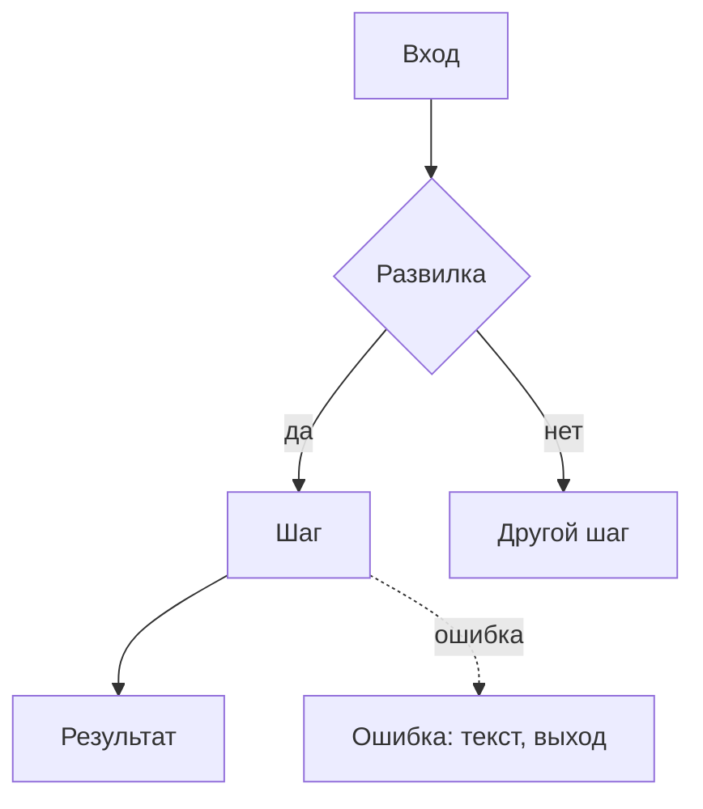

# Шаблон чертежа

Два варианта: полный — для фичи, короткий — для маленькой правки.

Читатели: **владелец** читает «Главное» и часть 1 — там всё для решений, без технического словаря;
**исполнитель** — агент, который будет строить и не сможет задать вопросов, — работает по частям 2
и 3. Ему нужны не знания, а твои решения: какие файлы, имена, значения, какой тест доказывает шаг.

Раздел, который к фиче не относится, — заголовок и одна строка «не относится, потому что…». У
пользовательской фичи без нового механизма так обычно закрываются разделы 8 и 20, у внутренней —
7, 11 и 12. Внутри разделов пиши только применимое.

**Объём:** «Главное» — одна страница; «Главное» с частью 1 — до 180 строк; часть 2 — до 170; часть 3
— до 250; весь чертёж — 300–600. Больше — значит, есть повторы, очевидное или проза вместо таблиц.

## Полный чертёж

````markdown
# <Название фичи> — чертёж

**Статус:** черновик, ждёт решений владельца | согласован
**Дата:** ГГГГ-ММ-ДД · **Проект:** <имя> · **Тип фичи:** пользовательская | внутренняя | смешанная ·
**Где работает:** <веб-админка, бот, фоновая задача, внешний сервис…>

## Главное

**Что делаем и зачем.** 2–3 строки: для кого, какую боль снимаем, что будет успехом.

**Как это будет работать.** 4–7 пунктов: путь по шагам — что делает человек или что происходит,
когда срабатывает механизм, — и главные решения, каждое с последствием для пользователя или
бизнеса.

**Как будем делать.** 4–8 пунктов высоким уровнем: что появится в системе, что переиспользуем из
проекта, что пишем заново и почему не подошло имеющееся.

**На чём основано.** 2–4 главные опоры: практика или источник → что из этого берём (подробно —
раздел 3).

**Нашлось по дороге.** <устаревший код и старые дефекты в затронутой области: что это и чем
мешает; что с ними делать — в развилках. Если ничего — строку убрать>

**Ждут вашего решения.**
1. <вопрос> — рекомендую <вариант>, потому что <…> (подробно — Р1)
2. …

**Выкатка:** <куда после реализации и тестов: дев, стейдж или прод — по решению владельца (Р…);
что проверяем после выкатки>.

**Объём:** <N шагов; работа агента — около X ч (оценка); что займёт время на самом деле — прогоны,
CI, внешние ожидания; что нужно от владельца и сколько его времени>.

**Не проверено:** <что и почему>.

---

# Часть 1. Для владельца: как это работает

## 1. Что известно и что додумано

- **Сказал владелец:** <что он сказал или явно подтвердил, в том числе в обсуждении до чертежа>
- **Рекомендовал агент, владелец не подтвердил:** <если было обсуждение — что и где это в развилках>
- **Нашлось в проекте:** <похожие функции, ограничения, масштаб с цифрами, найденные дефекты>
- **Додумано:** <ключевые допущения с пометкой [ДОПУЩЕНИЕ] и причиной>

## 2. Цели, не-цели, анти-цели

- **Цели:** 2–5 результатов для пользователя и бизнеса. Для внутреннего механизма — гарантии в
  числах: сколько данных допустимо потерять, сколько простоять, за какое время доходят изменения.
- **Не-цели:** что не входит в эту версию и почему.
- **Анти-цели:** что сделает фичу провалом, даже если она работает.

## 3. На чём основано

| Практика | Кто так делает | При каком масштабе окупается | Берём сейчас? | Почему | Источник, дата |
|---|---|---|---|---|---|

Только то, что повлияло на решения; строки «не берём» так же важны, как «берём».

## 4. Варианты и масштаб

**Масштаб проекта:** <данные, нагрузка, кто обслуживает, бюджет — с источником цифр>.

Если путь один — одна строка «путь один, потому что…». Иначе варианты или лестница ступеней:

| | Вариант / ступень 1 | Вариант / ступень 2 |
|---|---|---|
| Что делает человек или механизм | | |
| От чего защищает / что даёт | | |
| Стоит: сложность и места для сбоев, деньги в месяц, обслуживание | | |
| Закрепляет | | |
| Нужен, когда | | |

**Рекомендую:** <вариант> — потому что <…, со ссылкой на раздел 3>.
**Переходить выше, когда:** <измеримое условие>.
**Отвергнуты:** <вариант> — проиграл на <…>, вернётся, если <…>.

## 5. Как это работает

Для пользовательской фичи — сценарии с конкретными людьми. Для внутреннего механизма — сценарии
его работы: обычный проход, сбой, восстановление.

**Сценарий 1 — <название>.** <Кто, контекст, состояние.>
1. …
2. **Главный момент:** <ради чего всё делается>
- **Если сбой:** <что происходит, кто узнаёт, как выбираемся>



## 6. Решения владельца

### Р1. <Вопрос так, как его понял бы владелец>
**Почему решать сейчас:** <что от ответа зависит: поведение для людей, данные, деньги, надёжность>
- **А. <вариант>** — даёт: …; стоит: …; закрепляет: …
- **Б. <вариант>** — даёт: …; стоит: …; закрепляет: …
- **В. Самый простой: без этого / как сейчас** — даёт: …; стоит: …
**Рекомендую А**, потому что <…>.
**Если не решить:** <что сделает исполнитель по умолчанию и что увидит пользователь>

### Принято
Заполняется после ответов владельца: решение, дата.

---

# Часть 2. Для исполнителя: поведение в деталях

## 7. Точки контакта и состояния

| Точка контакта | Первый раз / пусто | Загрузка | Есть данные | Частично | Ошибка | Нет прав | Успех |
|---|---|---|---|---|---|---|---|
| <экран, сообщение, команда> | <что видит и может сделать> | | | | | | |

Колонки — под фичу (для бота: «сообщение устарело»; для офлайн-приложения: «нет сети»). Пустых
клеток нет: «не бывает, потому что…» — тоже ответ.

Для инструментов, которые вызывает ИИ-агент, вместо неё — таблица инструментов:

| Инструмент | Когда вызывать / когда нет | Параметры | Что возвращает | Читает / меняет / необратимо | Защита от дублей | Ошибки: код и что в них сказано |
|---|---|---|---|---|---|---|

## 8. Внутренний механизм: гарантии, данные, отказы

Гарантии в числах, источник правды и правило конфликтов, связь идентификаторов, повтор и двойной
запуск, восстановление и его проверка, доступы. Сигналы о работе и обслуживание — в разделе 20,
деньги — в разделе 4, что видит человек при сбое — в разделе 9.

| Что ломается | Как предотвращаем | Как узнаём (кто, за какое время) | Как восстанавливаемся | Что теряется | Чем покрыт |
|---|---|---|---|---|---|

## 9. Ошибки и восстановление

| Ситуация | Как предотвращаем | Что видит человек (текст целиком) | Как выбирается | Что сохраняется |
|---|---|---|---|---|

## 10. Крайние случаи

| Случай | Что происходит | Как обрабатываем |
|---|---|---|

## 11. Скорость и обратная связь

| Действие | Ожидаемое время | Что видит человек, пока ждёт | Если дольше |
|---|---|---|---|

## 12. Тексты интерфейса

| Где | Текст |
|---|---|

Тексты из таблиц ошибок и состояний здесь не повторяй.

## 13. Доступность, локализация, деньги, данные, закон

Только то, что касается фичи.

## 14. Что сознательно не делаем

- <что> — потому что <сейчас не нужно людям / ждём данных / лишнее обслуживание на нашем
  масштабе>; вернёмся, когда <условие>. «Дольше делать» — не причина

## 15. Решения агента — на проверку

Только те, с которыми владелец мог бы разумно не согласиться (обычно до десяти). Всегда — решения
мимо того, что в проекте уже есть, если они не стали развилкой, с причиной. Новые для человека
настройки, кнопки и сообщения, о которых владелец не просил, сюда не входят — это развилки
раздела 6.

- <решение> — <почему так> (<основание: правило проекта, документация, практика из раздела 3>)

---

# Часть 3. Для исполнителя: как реализовать

## 16. Что уже есть и переиспользуем

<Модули, сервисы, утилиты проекта с путями: что берём как есть, что расширяем, что не используем и
почему. Устаревший код и дублирующие механизмы в затронутой области: используется ли, риск;
удаление — только по согласию владельца.>

## 17. Устройство

<Только то, что решается заранее; реализует выбранную в разделе 4 ступень, не больше. Где живёт
логика и у каждого изменяемого состояния — один владелец. Данные: сущности, поля, ограничения,
миграции и судьба существующих данных. Контракты: запросы, события, коды ошибок. Схема состояний
ключевого сценария в Mermaid (`stateDiagram-v2`). Защита от двойного выполнения. Фоновые задачи:
результат, сбой, перезапуск. Права: где проверяются. Наблюдаемость: события и метрики, по которым
видно, что фича работает и достигает цели раздела 2; что логируется. Запуск: перенос
существующих данных, постепенное включение, откат. Если вводится новый модуль — второе,
по-другому разделённое устройство и почему выбрано первое.>

## 18. Ловушки платформы и библиотек

<Найденное при сверке с документацией: ограничение или неочевидное поведение → как план его
обходит → какой тест проверяет. Что сверить не удалось.>

## 19. Сбои на новых путях

| Путь | Реальный отказ | Что видит человек | Чем покрыт (тест / обработка) |
|---|---|---|---|

Отказ без теста, без обработки и невидимый человеку — **критическая дыра**, закрыть в плане.
Отказы механизма из раздела 8 не повторяй.

## 20. Обслуживание

<Как понять, что работает: сигналы, пороги, кто получает; тревога на отсутствие успеха в срок.
Инструкция «если сломалось» в 3–5 шагов. Регулярная работа и что из неё автоматизировано.>

## 21. Приоритеты и объём

- **P0 — минимальная полная версия продакшн-качества, строится целиком:** всё, без чего фича
  работает неправильно, теряет данные, ломается молча, оставляет человека в тупике или открывает
  дыру в безопасности.
- **P1 — улучшает, но фича работает правильно и без этого:** откладывается только по причине из
  продукта и с условием возврата. «Дольше делать» — не причина.
- **P2 — не делаем, но не закрываем дорогу.**

**Объём:** работа агента в часах по шагам (оценка) — не в днях; что займёт время на самом деле —
прогоны, CI, внешние ожидания; что нужно от владельца. Ориентир: двусторонняя синхронизация
напоминаний с Google Календарём, 9 шагов с тестами, ревью и исправлениями, — около 2 ч работы
агента и 50 мин выкатки; заранее это было оценено в 11 дней.

**Выкатка:** окружения проекта; куда выкатываем после реализации и тестов (решение владельца);
порядок выкатки по правилам проекта; что проверяем после — логи, живой сценарий, метрики; как
откатить.

## 22. Шаги

Если есть пометки `[ПРОВЕРИТЬ]` или `[ЗАМЕРИТЬ]`, план начинается с них:

### Шаг 0: проверки и замеры

| Что проверяем | Как | Какое решение зависит | Что меняется в плане при каждом исходе |
|---|---|---|---|

### Шаг N: <что появляется>

**Файлы:** создать `путь`; изменить `путь` (что именно); тест `путь`
**Использует:** <точные имена из прошлых шагов>
**Даёт:** <точные имена для следующих шагов>
**Тест:** <имя и что проверяет — с конкретными значениями из чертежа>
**Готово, когда:** <команда проверки и ожидаемый результат>

Шаг — наименьшая единица со своим тестом; по нему можно написать ровно одну разумную вещь.
«Обработать ошибки», «добавить валидацию» — дыра. Тела функций не пиши, файлов с кодом не создавай;
код — только для неочевидного алгоритма. Порядок — от того, от чего зависят остальные. Тест до кода,
если так требуют правила проекта.

## 23. Критерии приёмки

Для каждого сценария и важной ошибки — «Дано / Когда / Тогда» с конкретными значениями. Для
внутреннего механизма — и отказ, и восстановление: «Дано: ночная копия не создалась. Тогда: к 10
утра владелец получил сообщение с причиной»; «Дано: копия за вчера. Когда: восстанавливаем её в
отдельную базу. Тогда: число заказов совпадает с основной на момент копии».

## 24. На что смотреть при ревью

Пять ситуаций, которые чертёж подразумевает, но ни один тест не проверяет, — с тестом в нужном
шаге. Пустой раздел — «проверил и не нашёл».

## 25. Открытые вопросы

| Вопрос | Кто отвечает | Блокирует старт? |
|---|---|---|
````

## Короткий чертёж (маленькая правка)

Объём — до 80 строк.

````markdown
# <Правка> — короткий чертёж

**Статус:** … · **Дата:** … · **Где:** <экран / команда / файл / задача>

**Что и зачем:** 2–3 строки.

**Вводные:** <что сказал или подтвердил владелец> · <что додумано или рекомендовано агентом без
подтверждения — это в «Решениях»>

**Опора:** <документация или практика, на которой держится решение>

**Переиспользуем:** <что из проекта; что идёт мимо имеющегося и почему>

**Сценарий:** 3–5 шагов, включая ветку сбоя.

**Состояния:** <только затронутые: загрузка, пусто, ошибка, успех — что видит человек>

**Отказы:** <для внутренней правки: что ломается, как узнаём, как восстанавливаемся>

**Ошибки и крайние случаи:** <список с обработкой>

**Тексты:** <ключевые строки>

**Решения:** <для владельца — в формате даёт / стоит / закрепляет с рекомендацией; свои — на проверку>

**Шаги реализации:** <файлы, что меняется, какой тест доказывает>

**Критерии приёмки:** <Дано / Когда / Тогда, 2–4 штуки>

**Объём:** <шаги; работа агента — около X ч (оценка); что нужно от владельца>
````

## Правила оформления

- Таблицы вместо прозы, где сравниваются однотипные вещи. Внутри таблицы нет пустых строк — они
  разрывают её.
- Каждый текст для пользователя — целиком, в кавычках.
- Одно и то же — в одном месте; в других — ссылка на раздел.
- Пути и имена — в обратных кавычках, точно как в проекте.
- Схемы — Mermaid (`flowchart` для сценария, `stateDiagram-v2` для состояний).
- Кликабельный HTML-макет — только по просьбе владельца; при расхождении прав документ.
