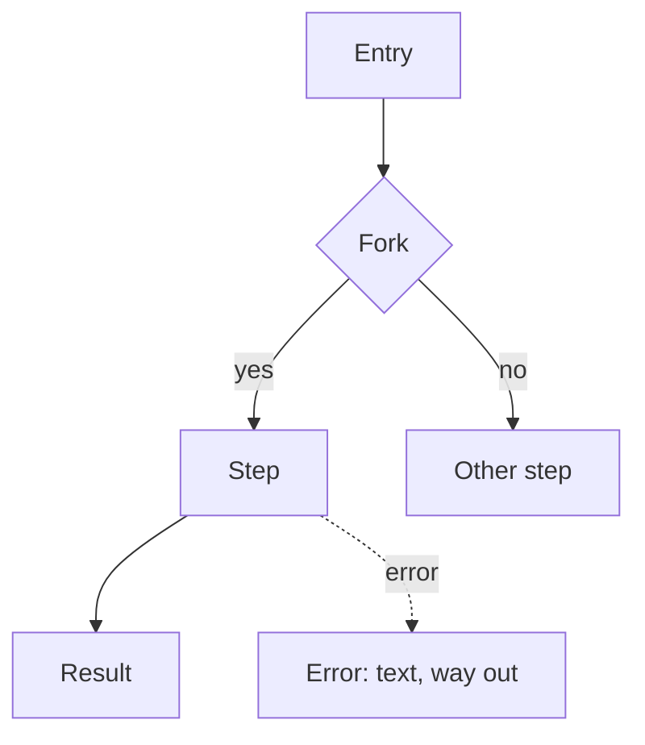

# Specification template

## Contents

- How to fill it in
- Document: "At a glance"; part 1, for the owner — sections 1–6; part 2, behaviour in detail —
  sections 7–15; part 3, how to build — sections 16–25
- Formatting rules

## How to fill it in

Write the document in the owner's language: translate headings, labels and markers. Keep as they
are: section numbers, fork labels F1… and priorities P0–P2, file, function and field names,
commands, paths, error codes and product names.

Two readers. The owner reads "At a glance" and part 1: everything needed for decisions, without
technical vocabulary. The implementer is an agent who will build the feature and cannot ask
questions; it works from parts 2 and 3 and needs your decisions, not knowledge — which files,
names and values, which test proves a step.

Drop a section that does not apply and name it in the "Does not apply" line at the top, with the
reason. For a user-facing feature without a new mechanism this is usually sections 8 and 20; for
an internal one, 7, 11 and 12. The other sections keep their numbers. Inside a section, write only
what applies.

**Length:** "At a glance" — one page. The rest is as long as the feature needs: its scenarios,
errors, failures and steps set the length, and a large feature in an existing project may take
several hundred lines more than a small one. What never adds length: repetition, the obvious and
prose where a table would do.

## Document

````markdown
# <Feature name> — specification

**Status:** draft, awaiting the owner's decisions | agreed
**Date:** YYYY-MM-DD · **Project:** <name> · **Feature type:** user-facing | internal | mixed ·
**Where it runs:** <web admin, bot, background job, external service…>
**Does not apply:** <section numbers — why; drop the line when every section applies>

## At a glance

**What we build and why.** 2–3 lines: for whom, what pain we remove, what success is.

**How it will work.** 4–7 points: the path step by step — what the person does or what happens
when the mechanism fires — and the main decisions, each with its consequence for the user or the
business.

**How we will build it.** 4–8 high-level points: what appears in the system, what we reuse from
the project, what we write anew and why the existing did not fit.

**What to watch.** The main risks of this feature from the pass; what is deferred and when we
come back to it.

**What it rests on.** 2–4 main supports: practice or source → what we take from it (details —
section 3).

**Found along the way.** <legacy code and old defects in the affected area: what they are and how
they get in the way; what to do with them — in the forks. Nothing — drop the line>

**Awaiting your decision.**
1. <question> — I recommend <option> because <…> (details — F1)
2. …

**Deployment:** <stage or test server, or straight to production — F…>.

**Scope:** <N steps; agent work — about X h (estimate); what really takes time — test runs, CI,
external waits; what is needed from the owner and how much of their time>.

**Not verified:** <what and why>.

---

# Part 1. For the owner: how it works

## 1. What is known and what was added

- **The owner said:** <what they said or explicitly confirmed, including in the discussion before
  the specification>
- **The agent recommended, the owner did not confirm:** <if there was a discussion — what, and
  where it went: a fork or "Agent decisions — for review">
- **Found in the project:** <similar functions, constraints, scale in numbers, defects found>
- **Added:** <key assumptions marked [ASSUMPTION], with the reason>
- **Contradictions between sources:** <who says what and where it is in the forks>

**Sources** — only those this feature rests on; the full list of materials stays where the project
keeps it:

| Code | What it is | From whom, date | Where it is | Weight |
|---|---|---|---|---|
| <CON> | <concept…> | <author, YYYY-MM-DD> | <path or link> | requirement / hypothesis / reference |

Mark key requirements in the document with their source code: **[CON]**.

## 2. Goals, non-goals, anti-goals

- **Goals:** 2–5 outcomes for the user and the business. For an internal mechanism — guarantees in
  numbers: how much data may be lost, how long it may be down, how fast changes arrive.
- **Non-goals:** what is not in this version and why.
- **Anti-goals:** what would make the feature a failure even if it works.
- **Today:** how people manage without the feature and what it costs them — the "as now" option
  of the forks.

## 3. What it rests on

| Practice | Who does it | Scale at which it pays off | Taking it now? | Why | Source, date |
|---|---|---|---|---|---|

Only what shaped decisions; "not taking" rows matter as much as "taking".

## 4. Options and scale

**Project scale:** <data, load, who maintains it, budget — with where the numbers come from>.

If there is one path — one line "one path, because…". Otherwise options or a ladder of levels:

| | Option / level 1 | Option / level 2 |
|---|---|---|
| What the person or the mechanism does | | |
| What it protects against / gives | | |
| Costs: complexity and failure points, money per month, maintenance | | |
| Locks in | | |
| Needed when | | |

**I recommend:** <option> — because <…, citing section 3>.
**Move up when:** <a measurable condition>.
**Rejected:** <option> — lost on <…>, comes back if <…>.

## 5. How it works

For a user-facing feature — scenarios with concrete people. For an internal mechanism — scenarios
of its work: the normal run, a failure, recovery.

**Entry points:** <where people come into the feature from → scenario number; for example: a chat
command → 1, a notification → 2, an action of the model → 3>

**Scenario 1 — <name>.** <Who, context, state.>
1. …
2. **Key moment:** <what it is all for>
- **On failure:** <what happens, who learns, how we get out>



## 6. Owner's decisions

### F1. <The question as the owner would understand it>
**Situation:** <a live example: who, where, what happens>
**Why it is yours to decide:** <what depends on the answer: behaviour for people, data, money,
reliability>
- **A. <option>** — gives: <what the user or the business gets; what the person sees, as text>;
  costs: <complexity and failure points, maintenance, money per month, the owner's time>; locks
  in: <what is hard to change later>
- **B. <option>** — gives: …; costs: …; locks in: …
- **C. Simplest: without it / as now** — gives: …; costs: …
**I recommend A** because <the reason in product terms and the ground it rests on>.
**If nobody decides:** <what the implementer does by default — normally the recommended option —
and what the user sees>

### Accepted
Filled in after the owner's answers: the decision, what it was chosen over and why, the date.
A fork settled by the owner's earlier decision in a similar situation is entered here too, marked
so, with what it rests on.

---

# Part 2. For the implementer: behaviour in detail

## 7. Touchpoints and states

| Touchpoint | First time / empty | Loading | Has data | Partial | Error | No permission | Success |
|---|---|---|---|---|---|---|---|
| <screen, message, command> | <what the person sees and can do> | | | | | | |

Columns fit the feature (for a bot: "message is outdated"; for an offline app: "no network"). No
empty cells: "cannot happen, because…" is an answer too.

For tools that an AI agent calls, use a tools table instead:

| Tool | When to call / when not | Parameters | What it returns | Reads / changes / irreversible | Duplicate protection | Errors: code and what they say |
|---|---|---|---|---|---|---|

## 8. Internal mechanism: guarantees, data, failures

Guarantees in numbers, source of truth and conflict rule, identifier mapping, retries and double
runs, recovery and its test, access. Signals of work and maintenance — in section 20, money — in
section 4, what the person sees on failure — in section 9.

| What breaks | How we prevent it | How we learn (who, how fast) | How we recover | What is lost | Covered by |
|---|---|---|---|---|---|

## 9. Errors and recovery

| Situation | How we prevent it | What the person sees (full text) | How they get out | What is kept |
|---|---|---|---|---|

## 10. Edge cases and seams with other functions

| Case | What happens | How we handle it |
|---|---|---|

| Neighbouring function | Where they meet | What happens | How we resolve it, which one wins |
|---|---|---|---|

## 11. Speed and feedback

| Action | Expected time | What the person sees while waiting | If it takes longer |
|---|---|---|---|

## 12. Interface texts

| Where | Text |
|---|---|

Do not repeat texts from the error and state tables here.

## 13. Accessibility, localisation, money, data, law

Only what concerns the feature.

## 14. What we deliberately do not do

- <what> — because <people do not need it now / waiting for data / needless maintenance at our
  scale>; we come back when <condition>. "Takes longer" is not a reason

## 15. Agent decisions — for review

Only those the owner could reasonably disagree with (usually up to ten). Always — decisions that
bypass what the project already has, if they did not become a fork, with the reason. New settings,
buttons and messages for people that the owner did not ask for do not go here — they are forks in
section 6.

- <decision> — <why> (<ground: project rule, documentation, practice from section 3>)

---

# Part 3. For the implementer: how to build

## 16. What exists and what we reuse

<The project's modules, services and utilities with paths: what we take as is, what we extend,
what we do not use and why. Legacy code and duplicate mechanisms in the affected area: whether
they are used, the risk; removal only with the owner's consent.>

## 17. Design

<Only what has to be decided upfront; implements the level chosen in section 4, no more. Where the
logic lives and one owner for each piece of mutable state. Data: entities, fields, constraints,
migrations and the fate of existing data. Contracts: requests, events, error codes. A state
diagram of the key scenario in Mermaid (`stateDiagram-v2`). Protection against double execution.
Background jobs: result, failure, restart. Permissions: where they are checked. Observability:
events and metrics that show the feature works and reaches the goal of section 2; what is logged.
If a new module is introduced — a second design split differently and why the first was
chosen.>

## 18. Platform and library traps

<Found when checking documentation: a limit or non-obvious behaviour → how the plan works around
it → which test checks it. What could not be checked.>

## 19. Failures on new paths

| Path | Realistic failure | What the person sees | Covered by (test / handling) |
|---|---|---|---|

A failure with no test, no handling and invisible to the person is a **critical gap** — close it in
the plan. Do not repeat the mechanism failures from section 8.

## 20. Maintenance

<How to tell it works: signals, thresholds, who receives them; an alert on the absence of success
on time. A "when it breaks" runbook in 3–5 steps. Regular work and what of it is automated.>

## 21. Priorities and scope

- **P0 — the minimal complete production-grade version, built in full:** everything without
  which the feature works wrong, loses data, fails silently, leaves a person stuck or opens a
  security hole.
- **P1 — improves things, but the feature works correctly without it:** deferred only for a
  product reason and with a condition to return. "Takes longer" is not a reason.
- **P2 — not doing it, but not closing the way to it.**

**Scope:** agent work in hours by step (estimate) — not in days; what really takes time — test
runs, CI, external waits; what is needed from the owner. Calibration: two-way sync of reminders
with Google Calendar, 9 steps with tests, review and fixes — about 2 h of agent work and 50 min of
deployment; it had been estimated upfront at 11 days.

## 22. Steps

**Rules every step keeps** — one line each, with exact values: the project's rules found in
reconnaissance, the unwritten ones included (money in minor units, time in UTC, deletion only
soft, the error code format, the language of texts for people), and the specification's
project-wide values. Every step's requirements include this block.

If there are [VERIFY] or [MEASURE] markers, the plan starts with them:

### Step 0: checks and measurements

| What we check | How | Which decision depends on it | What changes in the plan for each outcome |
|---|---|---|---|

### Step N: <what appears>

**Files:** create `path`; change `path` (what exactly); test `path`
**Uses:** <exact names from earlier steps>
**Provides:** <exact names for later steps>
**Test:** <name and what it checks — with concrete values from the specification; if it replaces
an external service with a stub, what it will not catch>
**Closes:** <scenario 2, the error «…» from section 9, acceptance criterion 3>
**Done when:** <check command and expected result>

A step is the smallest unit with its own test; it allows exactly one sensible implementation.
"Handle errors", "add validation" — a gap. What cannot be known before touching the code (a field
name in someone else's response, the final query) is not invented: the step says "decided by the
implementer, by the rule …" and how it is checked. No function bodies, no code files; code only
for a non-obvious algorithm. Order — from what the rest depends on. Test before code if the
project's rules require it.

If steps reach production separately (each its own issue or release), every step leaves
production safe: nothing becomes reachable for people before its protection — a permission check,
a limit, duplicate protection. A thing several steps use — a table, a setting, a type — is created
by one step, and the steps that use it come after it.

## 23. Acceptance criteria

For each scenario and important error — "Given / When / Then" with concrete values. For an
internal mechanism — both the failure and the recovery: "Given: the nightly copy was not created.
Then: by 10 a.m. the owner got a message with the reason"; "Given: yesterday's copy. When: we
restore it into a separate database. Then: the number of orders matches the main one at the time
of the copy".

## 24. What to look at in review

Five situations the specification implies but no test checks — each with a test in the right
step. If there are none, write "checked and found none".

## 25. Open questions

| Question | Who answers | Blocks the start? |
|---|---|---|
````

## Formatting rules

- Tables instead of prose where like things are compared. No blank lines inside a table — they
  break it.
- Every text for the user — in full, in quotes.
- Each thing in one place; elsewhere a reference to the section.
- Paths and names — in backticks, exactly as in the project.
- A statement about the existing project says where it was seen: what exists — a path or a name
  (`server/jobs/queue.js`, `sendNotification`); what is absent — where it was looked for ("no
  retries: searched `server/jobs/` and `server/routes/`"); not seen — [ASSUMPTION].
- Diagrams — Mermaid (`flowchart` for scenarios, `stateDiagram-v2` for states).
- HTML mock-ups and diagrams — only at the owner's request, per `references/mockups.md`; on a
  mismatch the document wins.
